# NASA Space Apps Challenge 2026

## Project overview

| | |
| --- | --- |
| **Project** | AURA: Autonomous Unified Risk Assessment |
| **Tagline** | Your crew's health, even when Earth is 20 minutes away. |
| **Challenge** | Create Health Monitoring Software for Astronauts on Space Missions |
| **Team** | NeuralAI |
| **Project lead** | Ibrahim Irfan |
| **Team members** | Ibrahim Irfan, Melvyn Avoa |

# AURA: Autonomous Unified Risk Assessment

### *Your crew's health, even when Earth is 20 minutes away.*

**Health monitoring that lets astronauts on long-duration missions assess their own health,
see changes early, and know exactly when to act or call the ground.**

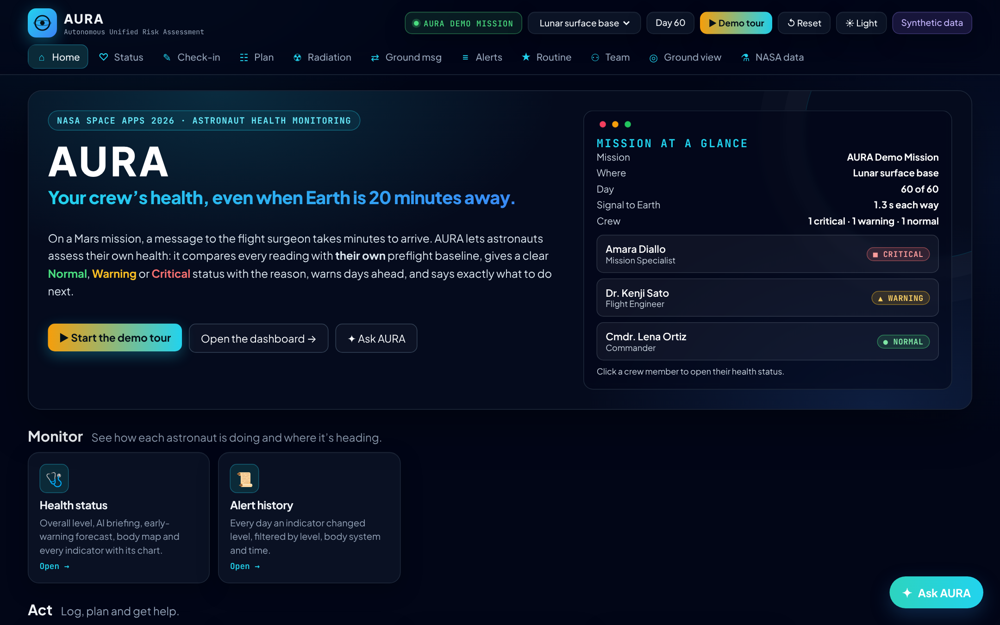

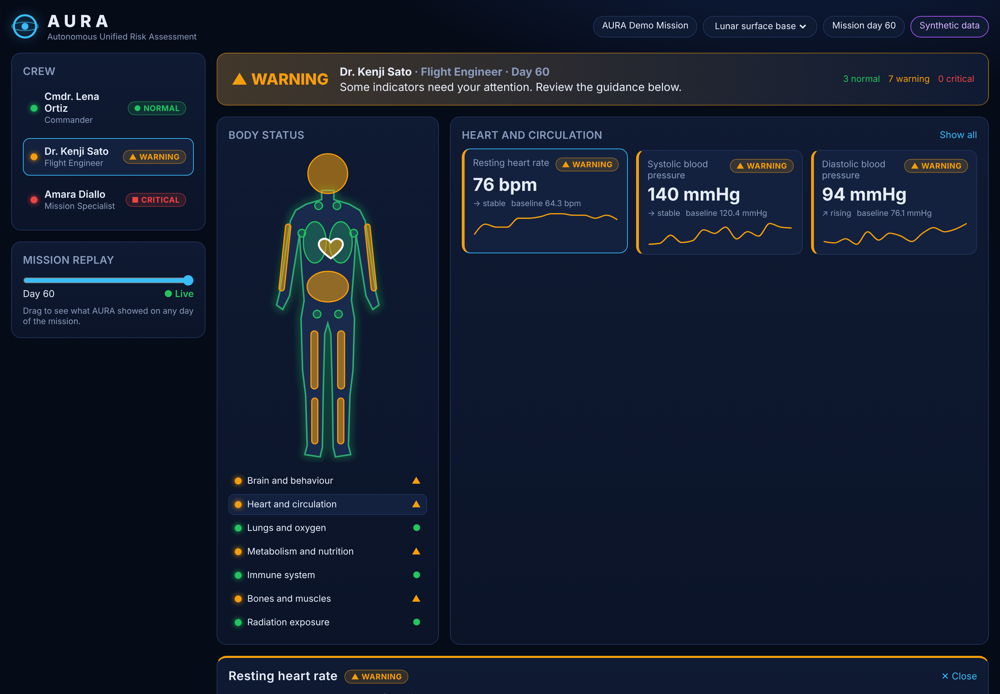

> **Prototype disclaimer:** AURA is a hackathon prototype. Its alert thresholds are
> *prototype rules* drawn from published research, **not clinically validated flight-medicine
> limits**. Demo telemetry is **synthetic**, the Inspiration4 panel is **real NASA OSDR data**,
> and your own imported readings are labelled **imported**. Every record says which it is.

## The problem

On long missions to the Moon or Mars, astronauts face NASA's five hazards of human
spaceflight: radiation, isolation and confinement, distance from Earth, altered gravity, and a
hostile closed environment. Communication delays mean they must spot health changes in
themselves. Most changes are gradual, and many stay inside "normal" Earth ranges while
already being abnormal *for that person*.

## What AURA does

| | Feature |
| --- | --- |
| 🩺 | **10 indicators** (heart rate, blood pressure, SpO2, glucose, temperature, sleep, mood, exercise, radiation), each mapped to NASA's hazards, with plain-language "why it matters" and "how to measure" notes |
| 📈 | **Personal baselines.** Each astronaut is compared with their own 7-day preflight baseline, so a sustained shift is caught even when it's still Earth-normal. An optional **adaptive in-flight baseline** blends in the last weeks of flight (capped at 1 SD of drift) so expected adaptation stops raising alerts |
| 🚦 | **Three transparent levels.** 🟢 Normal, 🟡 Warning, 🔴 Critical, with the reason and the next actions every time |
| 🧍 | **Clickable body figure** colored by each body system's worst indicator |
| ✦ | **AI flight surgeon** (Claude) that writes a 30-second daily briefing grounded in the astronaut's data |
| 📈 | **Early-warning forecast.** Projects each indicator's trend and flags any that would cross the edge of the personal baseline, a warning or a critical limit within 14 days, with a dashed projection and a shaded **95% confidence band** on the chart, an earliest-to-latest crossing range, and **related trends** (indicators moving together, such as heart rate with body temperature in a fever). Kenji's heart-rate warning is forecast 2 days before it fires |
| 🤒 | **Symptom log with triage.** Pick symptoms by body area and rate them 1 to 10. Fixed rules triage them: red flags (chest pain, breathing difficulty, sudden vision loss…) mean contact the flight surgeon now; vision changes (possible SANS), chills, late nausea or a symptom on 3 of the last 5 days need follow-up; early fluid-shift symptoms get self-care advice. Each symptom links to the readings worth checking |
| 📡 | **Message ground with a real signal delay.** ISS about 0.5 s, the Moon 1.3 s, Mars transit growing to about 12.5 minutes each way. A countdown shows the message travelling, the status packet goes with it, and a simulated flight-surgeon reply arrives after the round trip. On Mars, AURA's own guidance is the crew's first line of support |
| ☢ | **Radiation dose budget.** Career dose (earlier missions plus this one) against NASA's 600 mSv limit, the 30-day limit, the current rate, days left at that rate, and a projection to the end of the mission |
| 🛰 | **Ground view for the flight surgeon.** The whole crew on one screen, sorted by priority (the worst of telemetry, symptoms and radiation), with messages shown only once their signal arrives, plus **printable health reports** (save as PDF) for one person or the whole crew |
| ✅ | **Plausibility checks on check-ins.** Impossible values are blocked with a hint ("looks like °F, did you mean 37.0 °C?"); unusual ones (4+ SD from baseline, a sudden jump, systolic not above diastolic) ask you to confirm before saving |
| 🎙 | **Voice check-in.** Say "heart rate 62, blood pressure 118 over 76, slept six and a half hours, mild headache" and the form fills in (Web Speech API in the browser, transparent rules on the server). Nothing is saved until you press Log |
| 🗓 | **Countermeasure planner.** A timed plan for the day (exercise, sleep, measurements, radiation shielding, social time) that adjusts to the current alerts and explains every change |
| 👥 | **Crew wellbeing view.** A 0-100 wellbeing score per person and for the crew from mood, sleep, behavioural symptoms and exercise, with 30-day trends and team-level suggestions |
| 🔎 | **Timeline filters** by level, body system and day range |
| 💬 | **Ask AURA**: a chat button in the bottom-right corner on every screen. Ask anything (health, "how do I…", the NASA data) and get an answer, numbered steps and one-click buttons that take you to the right place. It knows which crew member, day and indicator you're viewing, **remembers** facts you tell it ("remember I get headaches after exercise"), and can act: open panels, jump to a day, draft a message to ground or pre-fill a symptom |
| 🎮 | **Gamified routine.** Daily tasks, streaks, points, levels and 11 badges reward measuring regularly and following up on warnings, plus **weekly challenges** (+50 each), a **crew board** and a shared crew goal |
| ⏪ | **Mission replay** to see what AURA showed on any day, plus ISS, lunar surface and Mars transit environments |
| 🧪 | **Real crew data.** Actual Inspiration4 bloodwork from NASA OSDR (metabolic panel, blood count, **71 immune cytokines**, **9 cardiovascular and inflammation proteins**, and the **Alamar 200-plex protein panels in serum and urine**), charted per crew member against lab ranges, with an **AI review** of each person's changes versus their own preflight baseline |
| 👩‍🚀 | **Editable crew.** Add or edit any number of members: name, role, age, personal baselines and a health scenario (5 to choose from). The AI isn't told the scenario, so it has to find the pattern |
| ➕ | **Custom indicators.** Add any measurement (body weight, HRV, steps, water intake, or your own) with its unit, typical range and warning/critical limits. It gets baselines, alerts, charts, check-ins, CSV import and AI coverage like the built-in ten |
| ⬆ | **Import your own data** from a CSV (one row per day) and become a crew member: alerts, tasks and the AI briefing all run on your readings |
| 🏠 | **Landing page and feature pages.** AURA opens on a home page with the story, a live crew snapshot and a menu of every feature; each feature has its own linked page, and Ask AURA can take you to any page ("take me to radiation") |
| 🌌 | **Space-style interface.** A dark theme by default with a ☀ Light switch in the header (remembered per browser), a glass header with the page menu, and layouts that work on phones. Every page passes an automated WCAG 2 AA accessibility check in both themes |
| ▶ | **Guided demo tour** that walks through the mission story, real NASA data, the new symptom, ground and radiation features, planner, team wellbeing, voice check-in, cytokines and your own data in 19 steps |

### Alert logic (in `backend/aura/alerts.py`)

1. **Critical:** the reading crosses a predefined critical limit, so the app tells the astronaut to contact the flight surgeon now.
2. **Warning:** the reading crosses a warning limit, **or** the last 3 readings all sit ≥1.5 SD on the
   adverse side of the personal baseline (mean ≥2 SD and a clinically meaningful change), **or**
   a single reading is ≥3.5 SD out (the app asks for a re-measure).
3. **Normal:** otherwise.

The AI never sets or changes a level. It explains and coaches, and the back end forces an
escalation whenever any reading is critical.

## Screens

| Daily plan, adjusted to alerts | Team wellbeing |
| --- | --- |
| 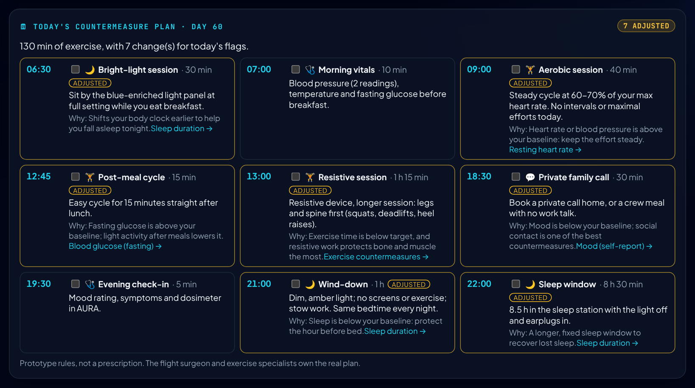 | 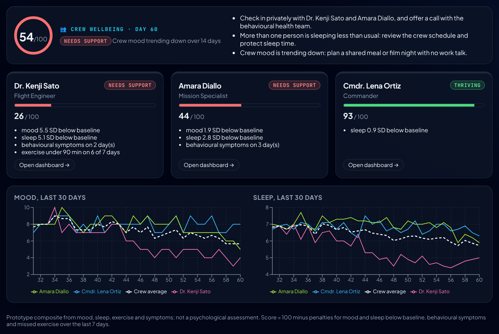 |

| Ask AURA | Light mode | Phone |
| --- | --- | --- |
| 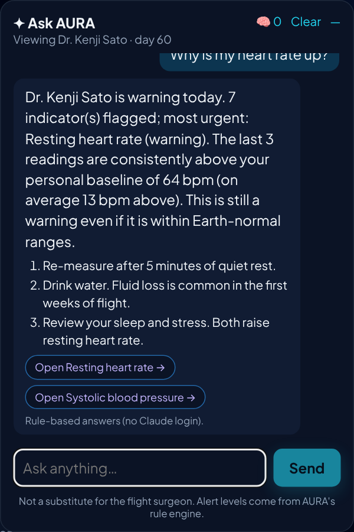 | 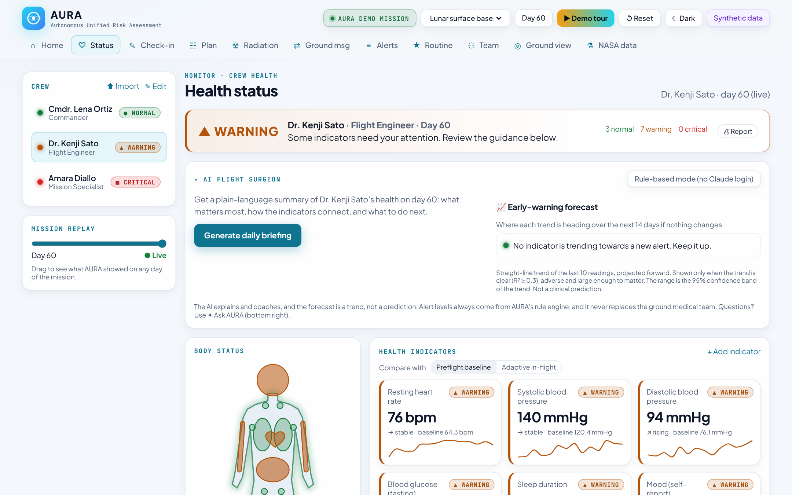 | 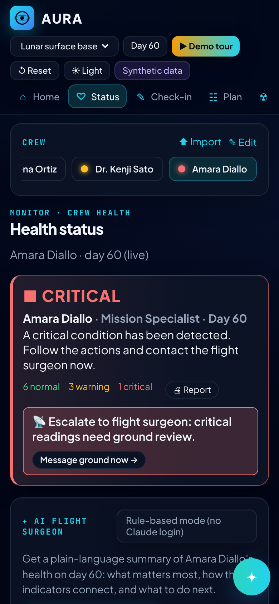 |

## Quick start

You need **Python 3.11+** and **Node 20+**. Use two terminals.

**Terminal 1: back end**

```bash
cd backend
python -m venv .venv && source .venv/bin/activate   # Windows: .venv\Scripts\activate
python -m pip install -r requirements.txt
python -m uvicorn aura.main:app --reload
```

> Using conda? Run `conda deactivate` first, or conda's Python can shadow the venv.

**Terminal 2: front end**

```bash
cd frontend
npm install
npm run dev
```

Open **http://localhost:5173**. AURA opens on its home page; click **▶ Demo tour** in the header (or **Start the demo tour** on the home page). Use **↺ Reset** to put the demo back to its starting state and **☀ Light / ☾ Dark** to switch themes. The **✦ Ask AURA**
button stays in the bottom-right corner, just below the tour card; opening it pauses the tour,
and minimising it brings the tour back.
The interactive API docs are at http://localhost:8000/docs.

### Turn on the AI flight surgeon (optional)

Use either of these, then restart the back end:

- **Anthropic CLI login:** `brew install anthropics/tap/ant`, then `ant auth login`. The profile is picked up automatically.
- **API key:** copy `backend/.env.example` to `backend/.env` and set `ANTHROPIC_API_KEY`.

Check http://localhost:8000/api/ai/status. Without credentials, AURA shows a rule-based
briefing instead, so the demo always works.

## Deploy a live demo

The whole app runs as **one web service**: the `Dockerfile` builds the React front end and FastAPI serves it next to the API, so the demo is a single URL.

**Render (free):** [](https://render.com/deploy?repo=https://github.com/Ibrahim278/AURA-Autonomous-Unified-Risk-Assessment)

1. Click the button (or in Render: **New > Blueprint** and pick this repo). `render.yaml` sets everything up.
2. Optional: paste an `ANTHROPIC_API_KEY` when asked to turn on AI answers. Without it AURA uses its offline answers, and every alert still works.
3. The free plan sleeps after 15 minutes idle, and the first visit then takes about a minute. Open the link a few minutes before judging.

**Any Docker host:** `docker build -t aura . && docker run -p 8000:8000 aura`, then open http://localhost:8000.

Everyone who opens the demo shares one mission, so use **Reset** in the header to start fresh.

## Real NASA data: Inspiration4


Scroll to **Real crew data · Inspiration4**. Switch between the metabolic panel, the blood
count, the **immune cytokines** (IL-6, TNF-α, IL-10, IFN-γ and 67 more) and the **cardiovascular and
inflammation proteins** (CRP, fibrinogen, haptoglobin…), pick a marker, and compare the four civilian crew from 92 days before launch to 194 days
after return. Pick a crew member and click **Review** for Claude's findings and recommendations.
Values are shown exactly as published. AURA's quality check leaves out one misaligned published
sample (C003 at L-92) and cytokine readings stuck at the assay's measurement limit, and says why.
The cytokine assays have no clinical reference range, so each person is compared with their own
preflight values.

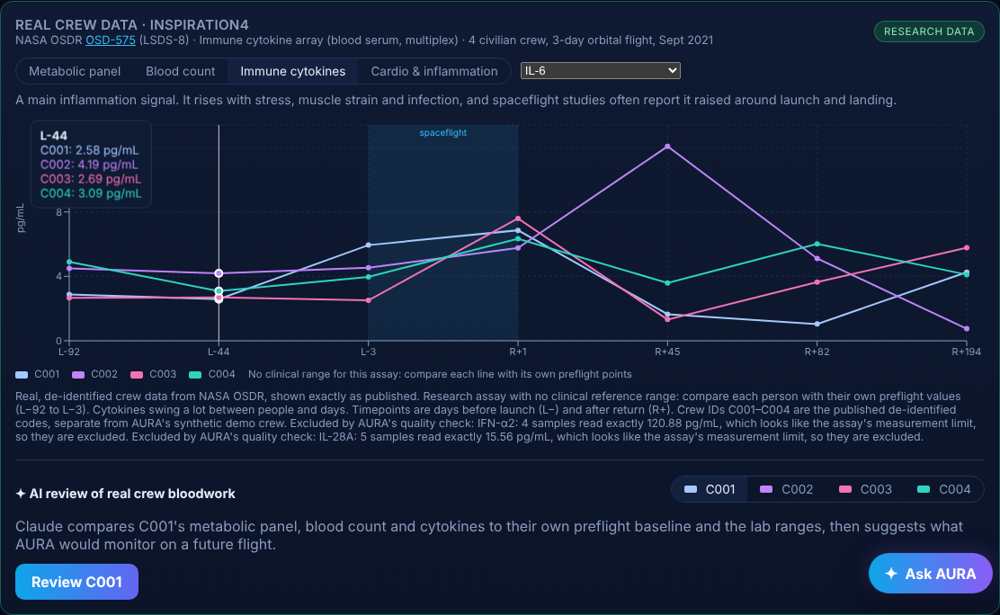

## Demo crew (synthetic)

| ID | Crew member | Story |
| --- | --- | --- |
| `aura-1` | Cmdr. Lena Ortiz | Adapts well. Only the expected in-flight changes. A veteran with 410 mSv from earlier missions, so her **radiation budget** reaches a warning (85% of the career limit) while every reading is normal. |
| `aura-2` | Dr. Kenji Sato | Sleep slips (warning day 42), then mood (46), then exercise and resting HR (50: 71 bpm, Earth-normal but well above his 64 bpm baseline), then blood pressure (54) and glucose (58). Logs trouble sleeping and low mood from day 44. |
| `aura-3` | Amara Diallo | Viral reactivation: fever builds from day 54 and turns **critical** on day 60. Logs tiredness and chills in the last days, which the symptom triage flags. |

Everyone gets a solar particle event dose on day 22 (lunar surface and Mars transit only). Demo symptom logs are synthetic and tagged "demo".
For the presentation script, see [docs/DEMO_SCRIPT.md](docs/DEMO_SCRIPT.md). To check everything works, follow [docs/TEST_CASES.md](docs/TEST_CASES.md). For how it's built (architecture, rules, AI layer, full API), see the
[technical documentation](docs/TECHNICAL.md). A screen-by-screen [UI guide](docs/AURA_UI_Guide.docx) (Word) explains every component.

### Make the crew your own


- **✎ Edit** (Crew panel): rename members, add or remove people (no fixed limit), set personal
  baselines, and choose a scenario: nominal, behavioural → cardio, immune fever, circadian
  disruption or exercise deconditioning. Saving regenerates the mission. **Restore demo crew**
  brings back the three above, and the demo tour does this automatically.
- **⬆ Import** (Crew panel): upload your own CSV. Days −7 to −1 build your baseline and days
  1, 2, 3… are mission days. Start from [`data/import_template.csv`](data/import_template.csv);
  the format is in [docs/DATA_SOURCES.md](docs/DATA_SOURCES.md#your-own-data-csv-import).
- **+ Add indicator** (Health indicators panel): track a new measurement. Start from a preset
  (body weight, heart rate variability, daily steps, water intake) or define your own.
  Definitions are saved in `data/custom_indicators.json`, so they survive a restart.
- **Check-in** panel: log today's readings by hand at any time, including custom indicators.
  Click **▶ Next day** to start the next mission day (61, 62, …) and keep logging day by day;
  the synthetic crew get new readings automatically, and resetting from the header returns to day 60.


Edited crews and imported data live in memory, so restarting the back end returns to the demo crew.

## Built for distance from Earth

Far from Earth, help is minutes away and the crew has to act on their own. Four features are
built around that:

- **🩺 Symptom log.** Log how you feel and get an instant rule-based triage, linked to the readings
  worth checking. Red flags always say "contact the flight surgeon now"; vision changes are flagged
  as possible SANS.
- **📡 Message ground.** Shows the true signal delay for the environment and day, sends your status
  packet, and counts down until the (simulated) flight surgeon's reply arrives. In Mars transit
  that's up to about 25 minutes round trip, so AURA's guidance comes first.
- **☢ Radiation dose budget.** How much of NASA's 600 mSv career limit is used (earlier missions
  plus this one), the 30-day window, the rate and a projection to the end of the mission.
- **🛰 Ground view and reports.** The flight surgeon sees the whole crew sorted by priority and can
  print or save a health report as PDF.

| Symptom triage | Message ground (Mars transit) |
| --- | --- |
| 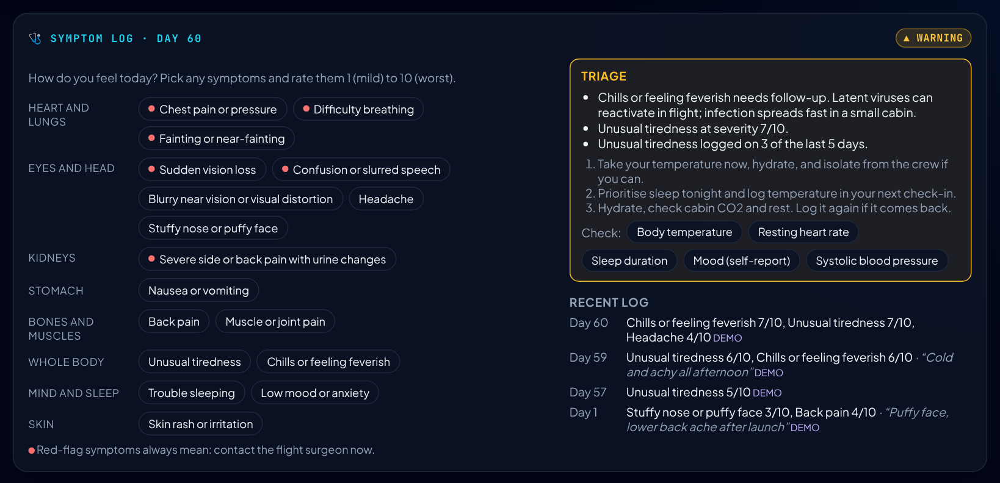 | 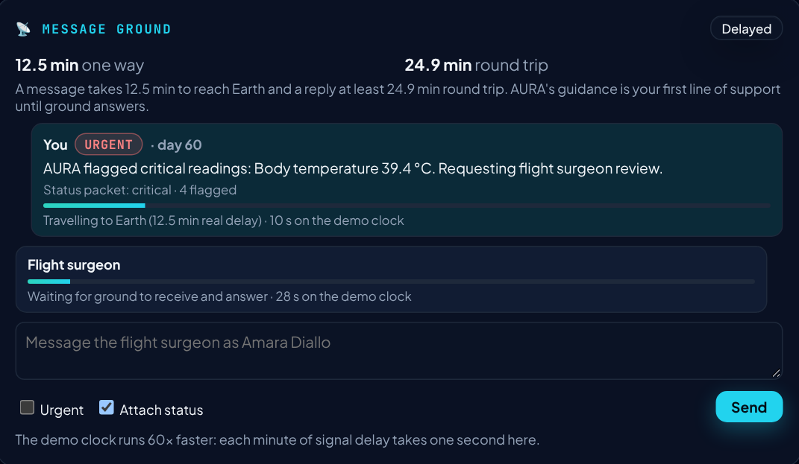 |

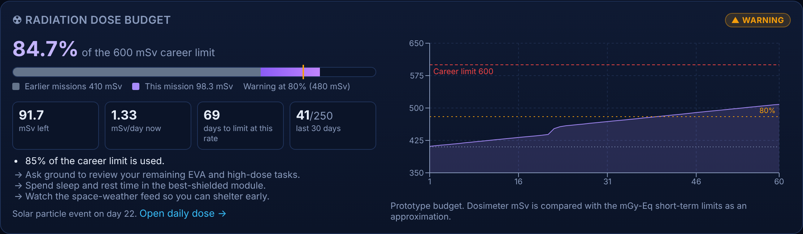

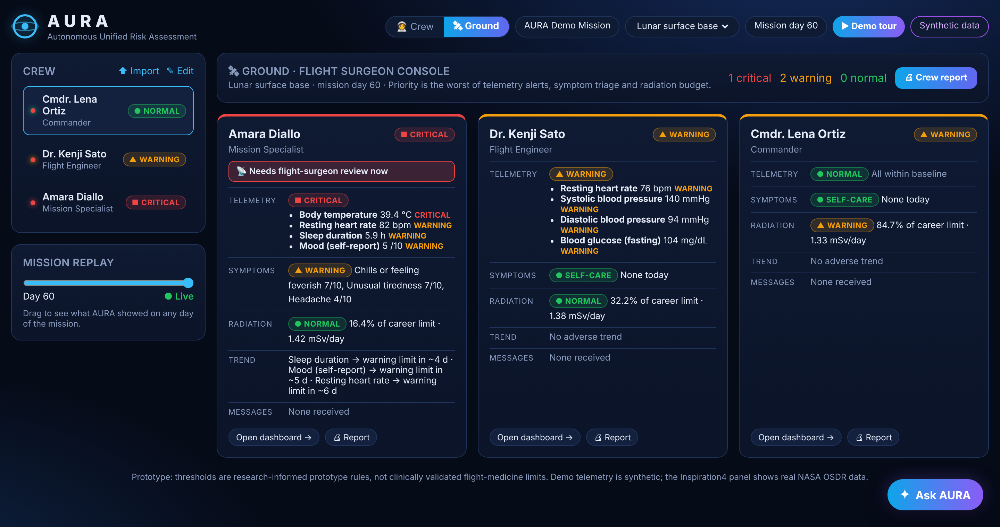

## Tech stack

| Layer | Technology | Used for |
| --- | --- | --- |
| Back end | **Python 3.11+**, **FastAPI** 0.162, **Uvicorn** 0.54 | REST API, interactive docs at `/docs` |
| Data validation | **Pydantic** 2.14 | Request validation and the AI's structured output schemas |
| Numerics | **NumPy** 2.5 | Seeded synthetic telemetry, statistics, trend fitting for the forecast |
| AI | **Anthropic Claude API** (`anthropic` Python SDK 2.8) | Daily briefing, Ask AURA assistant, review of the real crew bloodwork |
| Front end | **React** 19.3 (JavaScript/JSX), **Vite** 8.3 | Single-page app with hash-routed pages and the dev server (proxies `/api` to the back end) |
| Design | Plain CSS with theme tokens, Plus Jakarta Sans and JetBrains Mono (Google Fonts) | Dark space theme with a light alternative |
| Charts | **Recharts** 3.10 | Trend charts, sparklines, forecast projections, research charts |
| Testing | **pytest** 9.2, **httpx** | 179 back-end tests, including a mocked Claude API |
| Data | NASA OSDR (CSV), JSON, in-memory store | Real Inspiration4 labs; mission data kept in memory for zero-setup demos |

No database or cloud services are needed: clone, install, and run two terminals. To put it online as a single web service, see [Deploy a live demo](#deploy-a-live-demo).

## Architecture

Full details: [docs/TECHNICAL.md](docs/TECHNICAL.md).

```
frontend/  React 19 + Vite + Recharts dashboard  ──/api──►  backend/  FastAPI (Python)
                                                              ├─ indicators.py    catalog, limits, actions, references
                                                              ├─ alerts.py        baseline-deviation alert engine
                                                              ├─ forecast.py      trend projection, 95% band, related trends
                                                              ├─ symptoms.py      symptom catalog and rule-based triage
                                                              ├─ comms.py         signal delay and crew-to-ground messages
                                                              ├─ radiation.py     career and 30-day dose budget
                                                              ├─ ground.py        flight-surgeon overview and printable reports
                                                              ├─ simulator.py     seeded synthetic telemetry + health scenarios
                                                              ├─ importer.py      CSV import of your own data
                                                              ├─ custom.py        user-defined indicators
                                                              ├─ assistant.py     Ask AURA chat (answer, steps, actions)
                                                              ├─ research.py      NASA OSDR Inspiration4 labs + quality check
                                                              ├─ store.py         in-memory mission store + check-ins
                                                              ├─ gamification.py  tasks, streaks, points, badges, challenges, crew board
                                                              ├─ checks.py        plausibility checks and unit hints for check-ins
                                                              ├─ planner.py       daily countermeasure plan
                                                              ├─ wellbeing.py     crew wellbeing score and trends
                                                              ├─ voice.py         spoken check-in parser
                                                              └─ ai.py            Claude briefing, Q&A and research review,
                                                                                  each with a rule-based fallback
data/osdr/  NASA OSDR files (unchanged)        data/import_template.csv  example import
```

### API

| Method | Path | Purpose |
| --- | --- | --- |
| GET | `/api/mission` | Mission info, current day, environment, data notice |
| POST | `/api/mission/next-day` | Advance the mission one day; synthetic crew get that day's readings |
| POST | `/api/mission/reset` | Regenerate the mission (`environment`, `days`, `seed`); keeps the crew |
| GET | `/api/crew-options` | Scenarios, editable baselines and the default crew |
| PUT | `/api/mission/crew` | Replace the crew (name, role, age, scenario, baselines, prior radiation dose) and regenerate |
| POST | `/api/crew/import` | Add a crew member from your own CSV data |
| GET | `/api/crew/import/template` | Example CSV for the import |
| GET | `/api/indicators` | Indicator catalog: limits, explanations, actions, references |
| POST | `/api/indicators` | Add a custom indicator (name, unit, ranges, limits, body system, hazards) |
| DELETE | `/api/indicators/{key}` | Remove a custom indicator and its readings |
| GET | `/api/indicators/options` | Choices for the Add indicator form, and the saved custom definitions |
| GET | `/api/hazards` | NASA's five hazards mapped to indicators |
| GET | `/api/crew` | Crew with overall status |
| GET | `/api/crew/{id}/status?day=` | Per-indicator assessment and body-system rollup |
| GET | `/api/crew/{id}/telemetry` | Chart series with baseline and limits |
| GET | `/api/crew/{id}/forecast?day=` | Early-warning forecast: trend crossings within 14 days, 7-day projections with a 95% band, related trends |
| GET | `/api/symptoms/catalog` | Symptoms that can be logged, with red flags marked |
| GET / POST | `/api/crew/{id}/symptoms` | Symptom log up to a day with its triage / log symptoms (severity 1-10) |
| GET | `/api/crew/{id}/radiation?day=` | Radiation budget: career, 30-day and 1-year dose, rate and projection |
| GET | `/api/comms?day=` | Signal delay to Earth for the environment and day |
| GET / POST | `/api/crew/{id}/messages` | Messages to and from ground (replies appear after the round trip) / send one |
| GET | `/api/ground?day=` | Flight-surgeon overview of the whole crew, sorted by priority |
| GET | `/api/report?day=`, `/api/crew/{id}/report?day=` | Printable HTML health report (whole crew or one person) |
| GET | `/api/crew/{id}/alerts` | Timeline of alert-level changes |
| POST | `/api/crew/{id}/checkins/check` | Plausibility check before saving: errors with unit hints, warnings to confirm |
| POST | `/api/checkins/parse` | Turn a spoken or typed sentence into check-in values and symptoms |
| GET | `/api/crew/{id}/plan?day=` | Today's countermeasure plan |
| POST | `/api/crew/{id}/plan/{block}/toggle` | Tick a plan block done |
| GET / PUT | `/api/mission/baseline-mode` | Preflight or adaptive in-flight baseline |
| GET | `/api/wellbeing?day=` | Crew wellbeing scores, trends and suggestions |
| GET / POST | `/api/memory`, DELETE `/api/memory/{id}` | Ask AURA's saved notes |
| POST | `/api/crew/{id}/checkins` | Log manual measurements; returns the updated status |
| GET | `/api/crew/{id}/tasks` | Today's tasks, streaks, level, badges, weekly challenges and crew board |
| POST | `/api/crew/{id}/tasks/{task}/complete` | Tick off a wellness task |
| GET | `/api/ai/status` | Whether Claude is available |
| POST | `/api/crew/{id}/briefing` | AI (or rule-based) daily briefing |
| POST | `/api/crew/{id}/ask` | Ask the AI flight surgeon a question |
| POST | `/api/assistant` | Ask AURA: any question, with the current view; returns answer, steps and actions |
| GET | `/api/research` | Real research datasets and whether each is loaded |
| GET | `/api/research/{cmp\|cbc\|immune\|cardio\|alamar\|urine}` | Real Inspiration4 crew bloodwork from NASA OSDR |
| POST | `/api/research/crew/{C001..C004}/review` | AI review of one real crew member's bloodwork |

## Data and sources

AURA uses a **hybrid approach**: NASA research (OSDR, the Life Sciences Portal and the Human
Research Program) informs which indicators matter and how spaceflight shifts them, and
seeded **synthetic telemetry** stands in for continuous astronaut readings, which are not
public. Every record carries a `source` (`synthetic`, `research`, `manual` or `imported`), and each
threshold lists its references. The **Real crew data** panel charts actual Inspiration4 crew
bloodwork from NASA OSDR (OSD-575 metabolic panel and immune/cardiovascular multiplex arrays, OSD-569 blood count), unaltered and
labelled `research`, and Claude can review each real crew member's bloodwork against their own
preflight baseline. A quality check excludes one published CBC sample (C003, L-92) whose columns
are misaligned. See [docs/DATA_SOURCES.md](docs/DATA_SOURCES.md).

Export the dataset with `python -m aura.simulator --out ../data` (from `backend/`).

## AI usage disclosure

In line with the NASA Space Apps guidance on AI use, here is where AI was and wasn't used.

**AI inside the product**

- AURA calls the **Anthropic Claude API** for three features: the daily briefing, the
  **Ask AURA** assistant, and the review of the real Inspiration4 bloodwork. The model is set in
  `backend/aura/ai.py` and can be changed with `AURA_AI_MODEL`.
- The AI **never sets an alert level**. Normal, Warning and Critical always come from AURA's
  transparent rule engine (`alerts.py`), and the back end forces an escalation whenever any
  reading is critical, whatever the AI says. The forecast is plain statistics, not AI. Symptom
  triage, the radiation budget and the ground view are fixed rules, not AI.
- The flight surgeon's reply in **Message ground** is **simulated** by a rule-based template built
  from the crew member's AURA status, and is labelled as simulated. There is no real ground link.
- The AI is instructed not to diagnose, prescribe or dose medication, and to defer to the flight
  surgeon. Its answers are grounded in the data AURA sends it, and buttons it suggests are
  checked against the real dashboard before they are shown.
- Every AI feature has a **rule-based fallback**, so the app works fully without AI.

**AI used to build the project**

- The team used **Claude Code** (Anthropic's AI coding assistant) to help write code, tests and
  documentation. The team set the goals, design and features, reviewed and tested the results,
  and made all decisions. Every change was committed to this repository.

**Data and media**

- No AI-generated data is presented as real. Real data (NASA OSDR Inspiration4) is shown
  unchanged and labelled `research`. Synthetic telemetry comes from a seeded, deterministic
  Python simulator (not an AI model) and is labelled `synthetic`. User data is labelled
  `imported` or `manual`.
- Screenshots in `docs/screenshots/` are captures of the running app. No AI-generated images,
  video or audio are used.
- Alert thresholds come from cited, published sources (see each indicator's references) and are
  prototype rules, not clinically validated limits.

## Tests

```bash
cd backend && python -m pytest
```

179 tests cover the alert engine, the simulator scenarios, every API endpoint, gamification,
the OSDR parser and quality check, the CSV importer, crew editing, custom indicators, the forecast
(confidence band and related trends), symptom triage, ground messaging and signal delay, the radiation
budget, the ground view and reports, plausibility checks, the planner, the adaptive baseline, crew wellbeing,
voice parsing, weekly challenges and the crew board, Ask AURA (memory and actions), and the AI layer (with a mocked Claude API).
