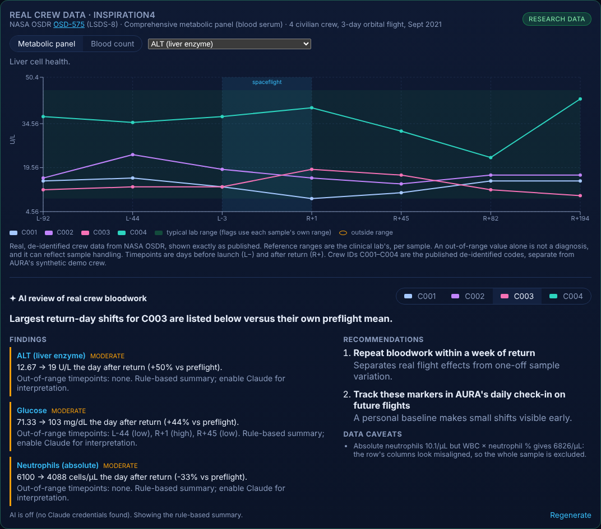
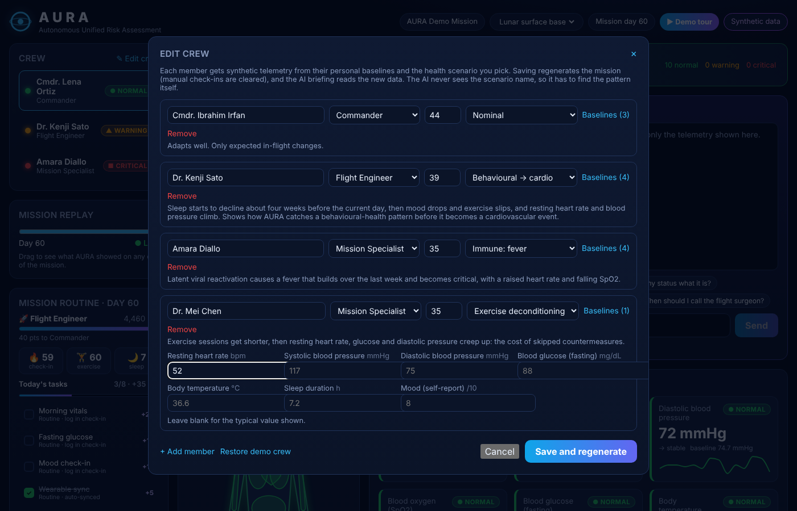
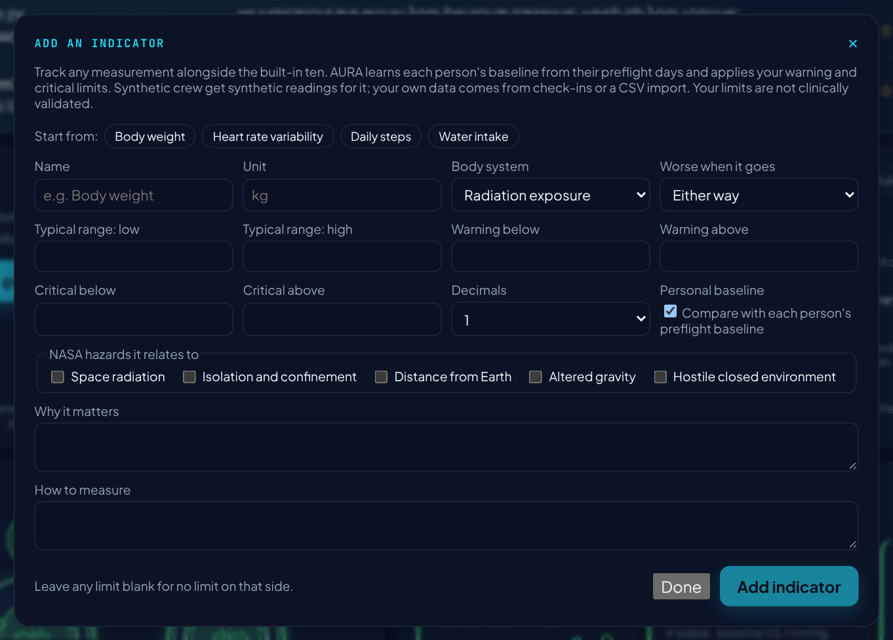

# NASA Space Apps Challenge 2026

## Project overview

| | |
| --- | --- |
| **Project** | AURA: Autonomous Unified Risk Assessment |
| **Challenge** | Create Health Monitoring Software for Astronauts on Space Missions |
| **Team** | NeuralAI |
| **Project lead** | Ibrahim Irfan |
| **Team members** | Ibrahim Irfan, Melvyn Avoa |

# AURA: Autonomous Unified Risk Assessment

**Health monitoring that lets astronauts on long-duration missions assess their own health,
see changes early, and know exactly when to act or call the ground.**


> **Prototype disclaimer:** AURA is a hackathon prototype. Its alert thresholds are
> *prototype rules* drawn from published research, **not clinically validated flight-medicine
> limits**. Demo telemetry is **synthetic**, the Inspiration4 panel is **real NASA OSDR data**,
> and your own imported readings are labelled **imported**. Every record says which it is.

## The problem

On long missions to the Moon or Mars, astronauts face NASA's five hazards of human
spaceflight: radiation, isolation and confinement, distance from Earth, altered gravity, and a
hostile closed environment. Communication delays mean they must spot health changes in
themselves. Most changes are gradual, and many stay inside "normal" Earth ranges while
already being abnormal *for that person*.

## What AURA does

| | Feature |
| --- | --- |
| 🩺 | **10 indicators** (heart rate, blood pressure, SpO2, glucose, temperature, sleep, mood, exercise, radiation), each mapped to NASA's hazards, with plain-language "why it matters" and "how to measure" notes |
| 📈 | **Personal baselines.** Each astronaut is compared with their own 7-day preflight baseline, so a sustained shift is caught even when it's still Earth-normal |
| 🚦 | **Three transparent levels.** 🟢 Normal, 🟡 Warning, 🔴 Critical, with the reason and the next actions every time |
| 🧍 | **Clickable body figure** colored by each body system's worst indicator |
| ✦ | **AI flight surgeon** (Claude) that writes a 30-second daily briefing grounded in the astronaut's data |
| 📈 | **Early-warning forecast.** Projects each indicator's trend and flags any that would cross the edge of the personal baseline, a warning or a critical limit within 14 days, with a dashed projection on the chart. Kenji's heart-rate warning is forecast 2 days before it fires |
| 💬 | **Ask AURA**: a chat button in the bottom-right corner on every screen. Ask anything (health, "how do I…", the NASA data) and get an answer, numbered steps and one-click buttons that take you to the right place. It knows which crew member, day and indicator you're viewing |
| 🎮 | **Gamified routine.** Daily tasks, streaks, points, levels and badges reward measuring regularly and following up on warnings |
| ⏪ | **Mission replay** to see what AURA showed on any day, plus ISS, lunar surface and Mars transit environments |
| 🧪 | **Real crew data.** Actual Inspiration4 bloodwork from NASA OSDR (metabolic panel and blood count), charted per crew member against lab ranges, with an **AI review** of each person's changes versus their own preflight baseline |
| 👩‍🚀 | **Editable crew.** Add or edit up to 6 members: name, role, age, personal baselines and a health scenario (5 to choose from). The AI isn't told the scenario, so it has to find the pattern |
| ➕ | **Custom indicators.** Add any measurement (body weight, HRV, steps, water intake, or your own) with its unit, typical range and warning/critical limits. It gets baselines, alerts, charts, check-ins, CSV import and AI coverage like the built-in ten |
| ⬆ | **Import your own data** from a CSV (one row per day) and become a crew member: alerts, tasks and the AI briefing all run on your readings |
| ▶ | **Guided demo tour** that walks through the mission story, real NASA data and your own data in 13 steps |

### Alert logic (in `backend/aura/alerts.py`)

1. **Critical:** the reading crosses a predefined critical limit, so the app tells the astronaut to contact the flight surgeon now.
2. **Warning:** the reading crosses a warning limit, **or** the last 3 readings all sit ≥1.5 SD on the
   adverse side of the personal baseline (mean ≥2 SD and a clinically meaningful change), **or**
   a single reading is ≥3.5 SD out (the app asks for a re-measure).
3. **Normal:** otherwise.

The AI never sets or changes a level. It explains and coaches, and the back end forces an
escalation whenever any reading is critical.

## Quick start

You need **Python 3.11+** and **Node 20+**. Use two terminals.

**Terminal 1: back end**

```bash
cd backend
python -m venv .venv && source .venv/bin/activate   # Windows: .venv\Scripts\activate
python -m pip install -r requirements.txt
python -m uvicorn aura.main:app --reload
```

> Using conda? Run `conda deactivate` first, or conda's Python can shadow the venv.

**Terminal 2: front end**

```bash
cd frontend
npm install
npm run dev
```

Open **http://localhost:5173** and click **▶ Demo tour** in the header. The **✦ Ask AURA**
button stays in the bottom-right corner, just below the tour card; opening it pauses the tour,
and minimising it brings the tour back.
The interactive API docs are at http://localhost:8000/docs.

### Turn on the AI flight surgeon (optional)

Use either of these, then restart the back end:

- **Anthropic CLI login:** `brew install anthropics/tap/ant`, then `ant auth login`. The profile is picked up automatically.
- **API key:** copy `backend/.env.example` to `backend/.env` and set `ANTHROPIC_API_KEY`.

Check http://localhost:8000/api/ai/status. Without credentials, AURA shows a rule-based
briefing instead, so the demo always works.

## Real NASA data: Inspiration4



Scroll to **Real crew data · Inspiration4**. Switch between the metabolic panel and the blood
count, pick a marker, and compare the four civilian crew from 92 days before launch to 194 days
after return. Pick a crew member and click **Review** for Claude's findings and recommendations.
Values are shown exactly as published. AURA's quality check leaves out one misaligned published
sample (C003 at L-92) and says why.

## Demo crew (synthetic)

| ID | Crew member | Story |
| --- | --- | --- |
| `aura-1` | Cmdr. Lena Ortiz | Adapts well. Only the expected in-flight changes. |
| `aura-2` | Dr. Kenji Sato | Sleep slips (warning day 42), then mood (46), then exercise and resting HR (50: 71 bpm, Earth-normal but well above his 64 bpm baseline), then blood pressure (54) and glucose (58). |
| `aura-3` | Amara Diallo | Viral reactivation: fever builds from day 54 and turns **critical** on day 60. |

Everyone gets a solar particle event dose on day 22 (lunar surface and Mars transit only).
For the presentation script, see [docs/DEMO_SCRIPT.md](docs/DEMO_SCRIPT.md).

### Make the crew your own



- **✎ Edit** (crew sidebar): rename members, add or remove people (up to 6), set personal
  baselines, and choose a scenario: nominal, behavioural → cardio, immune fever, circadian
  disruption or exercise deconditioning. Saving regenerates the mission. **Restore demo crew**
  brings back the three above, and the demo tour does this automatically.
- **⬆ Import** (crew sidebar): upload your own CSV. Days −7 to −1 build your baseline and days
  1, 2, 3… are mission days. Start from [`data/import_template.csv`](data/import_template.csv);
  the format is in [docs/DATA_SOURCES.md](docs/DATA_SOURCES.md#your-own-data-csv-import).
- **+ Add indicator** (Health indicators panel): track a new measurement. Start from a preset
  (body weight, heart rate variability, daily steps, water intake) or define your own.
  Definitions are saved in `data/custom_indicators.json`, so they survive a restart.
- **Check-in** panel: log today's readings by hand at any time, including custom indicators.



Edited crews and imported data live in memory, so restarting the back end returns to the demo crew.

## Architecture

```
frontend/  React 19 + Vite + Recharts dashboard  ──/api──►  backend/  FastAPI (Python)
                                                              ├─ indicators.py    catalog, limits, actions, references
                                                              ├─ alerts.py        baseline-deviation alert engine
                                                              ├─ forecast.py      trend projection / early warning
                                                              ├─ simulator.py     seeded synthetic telemetry + health scenarios
                                                              ├─ importer.py      CSV import of your own data
                                                              ├─ custom.py        user-defined indicators
                                                              ├─ assistant.py     Ask AURA chat (answer, steps, actions)
                                                              ├─ research.py      NASA OSDR Inspiration4 labs + quality check
                                                              ├─ store.py         in-memory mission store + check-ins
                                                              ├─ gamification.py  tasks, streaks, points, badges
                                                              └─ ai.py            Claude briefing, Q&A and research review,
                                                                                  each with a rule-based fallback
data/osdr/  NASA OSDR files (unchanged)        data/import_template.csv  example import
```

### API

| Method | Path | Purpose |
| --- | --- | --- |
| GET | `/api/mission` | Mission info, current day, environment, data notice |
| POST | `/api/mission/reset` | Regenerate the mission (`environment`, `days`, `seed`); keeps the crew |
| GET | `/api/crew-options` | Scenarios, editable baselines and the default crew |
| PUT | `/api/mission/crew` | Replace the crew (name, role, age, scenario, baselines) and regenerate |
| POST | `/api/crew/import` | Add a crew member from your own CSV data |
| GET | `/api/crew/import/template` | Example CSV for the import |
| GET | `/api/indicators` | Indicator catalog: limits, explanations, actions, references |
| POST | `/api/indicators` | Add a custom indicator (name, unit, ranges, limits, body system, hazards) |
| DELETE | `/api/indicators/{key}` | Remove a custom indicator and its readings |
| GET | `/api/indicators/options` | Choices for the Add indicator form, and the saved custom definitions |
| GET | `/api/hazards` | NASA's five hazards mapped to indicators |
| GET | `/api/crew` | Crew with overall status |
| GET | `/api/crew/{id}/status?day=` | Per-indicator assessment and body-system rollup |
| GET | `/api/crew/{id}/telemetry` | Chart series with baseline and limits |
| GET | `/api/crew/{id}/forecast?day=` | Early-warning forecast: trend crossings within 14 days, plus 7-day projections |
| GET | `/api/crew/{id}/alerts` | Timeline of alert-level changes |
| POST | `/api/crew/{id}/checkins` | Log manual measurements; returns the updated status |
| GET | `/api/crew/{id}/tasks` | Today's tasks, streaks, level and badges |
| POST | `/api/crew/{id}/tasks/{task}/complete` | Tick off a wellness task |
| GET | `/api/ai/status` | Whether Claude is available |
| POST | `/api/crew/{id}/briefing` | AI (or rule-based) daily briefing |
| POST | `/api/crew/{id}/ask` | Ask the AI flight surgeon a question |
| POST | `/api/assistant` | Ask AURA: any question, with the current view; returns answer, steps and actions |
| GET | `/api/research` | Real research datasets and whether each is loaded |
| GET | `/api/research/{cmp\|cbc}` | Real Inspiration4 crew bloodwork from NASA OSDR |
| POST | `/api/research/crew/{C001..C004}/review` | AI review of one real crew member's bloodwork |

## Data and sources

AURA uses a **hybrid approach**: NASA research (OSDR, the Life Sciences Portal and the Human
Research Program) informs which indicators matter and how spaceflight shifts them, and
seeded **synthetic telemetry** stands in for continuous astronaut readings, which are not
public. Every record carries a `source` (`synthetic`, `research`, `manual` or `imported`), and each
threshold lists its references. The **Real crew data** panel charts actual Inspiration4 crew
bloodwork from NASA OSDR (OSD-575 metabolic panel and OSD-569 blood count), unaltered and
labelled `research`, and Claude can review each real crew member's bloodwork against their own
preflight baseline. A quality check excludes one published CBC sample (C003, L-92) whose columns
are misaligned. See [docs/DATA_SOURCES.md](docs/DATA_SOURCES.md).

Export the dataset with `python -m aura.simulator --out ../data` (from `backend/`).

## Tests

```bash
cd backend && python -m pytest
```

80 tests cover the alert engine, the simulator scenarios, every API endpoint, gamification,
the OSDR parser and quality check, the CSV importer, crew editing, custom indicators, the forecast, Ask AURA, and the AI layer (with a
mocked Claude API).
